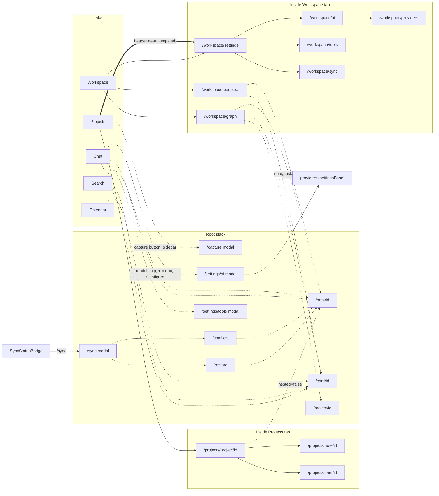
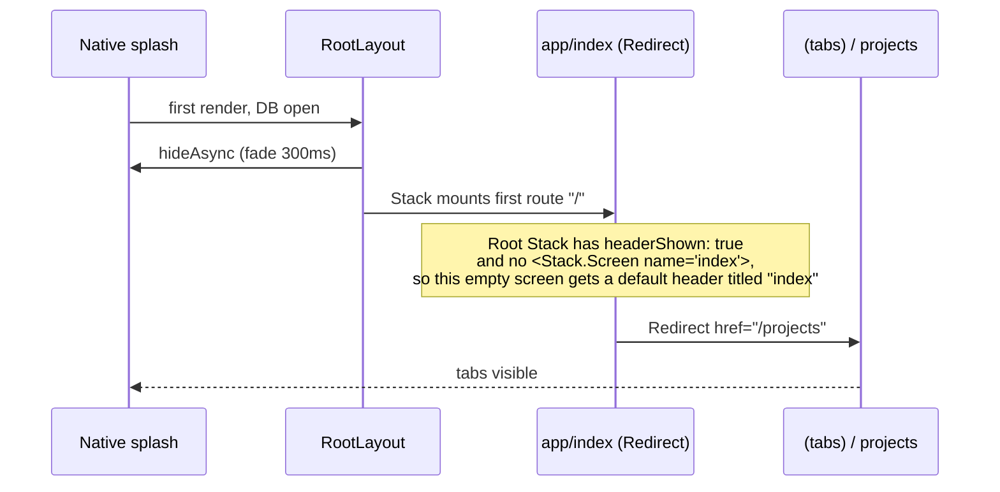
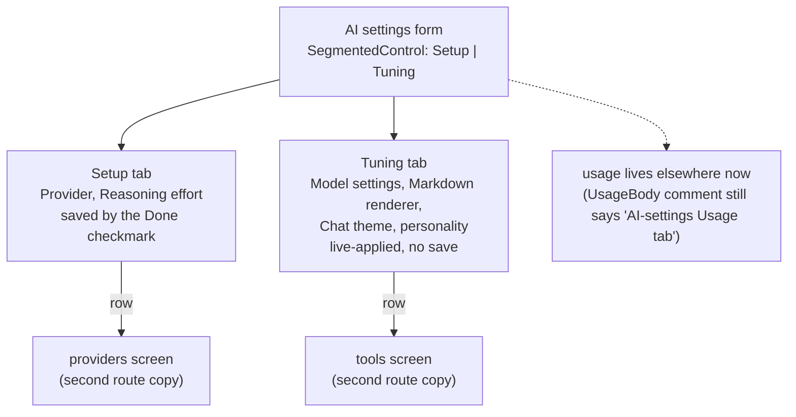
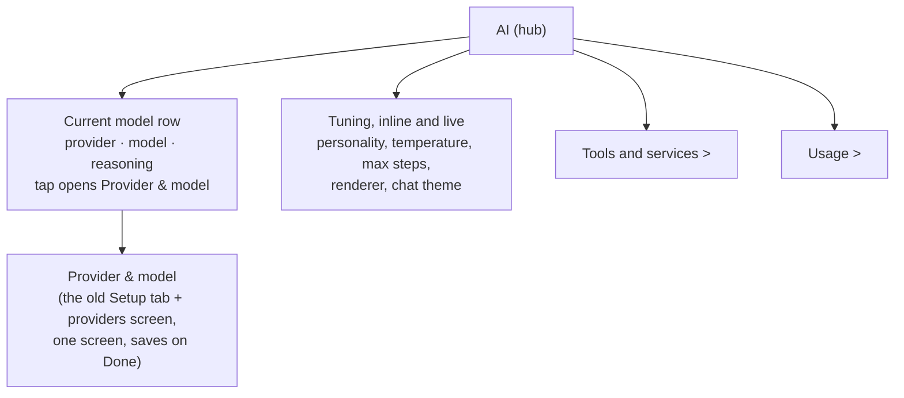
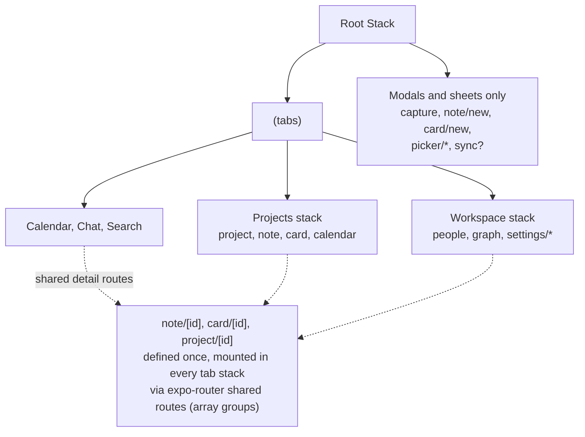

# Mobile routing analysis

Status: analysis only, no code changed. Written to drive the cleanup in PR 335 once the Workspace tab landed (it removed the reasons several routes exist).

Scope: `mobile/app/` (expo-router file routes), the three navigators that host them (root `Stack`, `NativeTabs`, per-tab `TabStack`), and every `router.push/replace/navigate` call in `mobile/src` and `mobile/app`.

## 1. Route tree today

Three navigators nest: the root `Stack` (`app/_layout.tsx`) owns the tab group plus every full-screen route; `NativeTabs` (`app/(tabs)/_layout.tsx`) owns five tabs; each tab has its own `TabStack`.

```mermaid
graph TD
  ROOT["Root Stack<br/>app/_layout.tsx<br/>headerShown: true by default"]

  ROOT --> IDX["index<br/>Redirect to /projects<br/>(not declared in the Stack)"]
  ROOT --> TABS["(tabs) NativeTabs<br/>headerShown: false"]

  subgraph TABGROUP[Tabs]
    TABS --> TP["projects"]
    TABS --> TC["calendar"]
    TABS --> TCH["chat"]
    TABS --> TW["workspace"]
    TABS --> TS["search (role=search)"]
  end

  TP --> TP1["index"]
  TP --> TP2["project/[id]"]
  TP --> TP3["project/calendar"]
  TP --> TP4["note/[id]"]
  TP --> TP5["card/[id]"]

  TC --> TC1["index"]
  TCH --> TCH1["index"]
  TS --> TS1["index"]

  TW --> TW1["index (home)"]
  TW --> TW2["people/index"]
  TW --> TW3["people/[id]"]
  TW --> TW4["people/team/[id]"]
  TW --> TW5["graph"]
  TW --> TW6["settings (hub)"]
  TW --> TWS["ai, providers, tools,<br/>appearance, usage, sync<br/>(1-line re-exports)"]

  subgraph ROOTROUTES[Root-level routes, full screen over the tab bar]
    ROOT --> R1["project/[id]  DUP"]
    ROOT --> R2["project/calendar  DUP"]
    ROOT --> R3["note/[id]  DUP"]
    ROOT --> R4["card/[id]  DUP"]
    ROOT --> R5["settings/ai  modal  DUP"]
    ROOT --> R6["settings/tools  modal  DUP"]
    ROOT --> R7["settings/appearance  modal  DUP"]
    ROOT --> R8["settings/providers  undeclared  DUP"]
    ROOT --> R9["settings/usage  undeclared  DUP"]
    ROOT --> R10["sync  modal  DUP"]
    ROOT --> R11["conflicts"]
    ROOT --> R12["restore  undeclared"]
    ROOT --> R13["capture  modal"]
    ROOT --> R14["note/new, card/new  modals"]
    ROOT --> R15["picker/tags, note, wikilink, due-date  formSheets"]
  end

  TWS -. "re-exports" .-> R5
  TP2 -. "same screen component" .-> R1
  TP4 -. "same screen component" .-> R3
  TP5 -. "same screen component" .-> R4
```

**Duplicates (DUP)** are the same screen reachable at two URLs:

| Screen | Tab copy | Root copy | Why it exists |
|---|---|---|---|
| Project, project calendar, note, task | `(tabs)/projects/...` | `app/project`, `app/note`, `app/card` | Tab copy keeps the tab bar while drilling in Projects; root copy is what Search, Graph, Calendar, Chat, People link to |
| AI settings, tools, appearance, usage, providers | `(tabs)/workspace/*.tsx` (re-export) | `app/settings/*` | Root copy is the Chat modal; Workspace copy keeps the tab bar |
| Sync | `(tabs)/workspace/sync.tsx` (re-export) | `app/sync.tsx` | Same |

Seven files in `(tabs)/workspace/` are one-line re-exports of root screens. `ProjectScreen` carries a `nested` flag and builds hrefs two ways (`ProjectScreen.tsx:149-154`, `:404-407`), and `AiSettingsForm.tsx:170` picks `/workspace` or `/settings` from `usePathname()`. Both are the cost of the duplication.

## 2. Who navigates where

Solid arrows push inside the current tab stack (tab bar stays). Dashed arrows push a root route (tab bar disappears, or a modal rises over it).

Observations from the call sites (grep of every `router.*` in `mobile/`):

- **Detail screens are split by origin, not by what they are.** From Projects you stay in the tab (`/projects/note/[id]`). From Search, Graph, People, Calendar, Chat and every markdown link you leave the tab bar (`/note/[id]`, `/card/[id]`). Back from the Graph lands on Workspace but the destination hid the tab bar on the way.
- **Settings has four front doors.** Chat uses root modals (`/settings/ai`, `/settings/tools`, five call sites in `chat/index.tsx`). Projects header and sidebar use `/workspace/settings` (a cross-tab push that switches the tab). Workspace rows push `/workspace/*`. The sync badge uses the root `/sync` modal while Workspace uses `/workspace/sync`.
- **Three screens are never declared in the root Stack** (`settings/providers`, `settings/usage`, `restore`) so they inherit the default header; they work but their title and presentation are accidental.
- **Params carry chrome.** `back: "Graph"`, `back: "Search"` etc. exist only to label the back button because the root stack does not know where you came from (see the comment in `_layout.tsx`: iOS read "(tabs)").
- **Conflicts and Restore are reachable only through the Sync modal**, which is reachable from the badge or Workspace. Two levels deep for a recovery action.

## 3. Startup flash

Boot path: `RootLayout` opens the DB synchronously in a `useState` initializer (so the "Opening Cairn…" screen essentially never shows) and hides the splash in an effect. Then the Stack mounts and the first route is `/`, which is `app/index.tsx`, a `<Redirect href="/projects">`.

Likely cause, to confirm with a screen recording: the splash fades out (300ms) while the redirect screen is still mounted, and that screen is an auto-registered root Stack screen with the default header (`headerShown: true` in `RootNavigator`), so a header reading "index" is briefly visible. The comment in `app/index.tsx` also notes the tabs group has no `index` route, which is why the redirect is needed at all.

Fix options, cheapest first:

1. Declare `<Stack.Screen name="index" options={{ headerShown: false }} />` (removes the visible header; the redirect frame stays but is blank, background already themed).
2. Hold the splash until the first tab has rendered (move `hideAsync` into the Projects screen, or `onLayout` of the tabs), so no intermediate frame is ever visible.
3. Remove the redirect: make Projects the tab group's index (`(tabs)/(projects)/index` with an array group) or set `unstable_settings.anchor = "(tabs)"`. Biggest change and ties into the duplicate-route work below, so it belongs in that plan rather than a standalone fix.

Recommend 1 now, and 3 as part of the restructure if it falls out for free.

## 4. AI settings

Today (`AiSettingsForm.tsx`, 1347 lines, shown as a root modal or a Workspace push):

Problems:

- The segment mixes two save models: Setup is transactional (Done), Tuning is live. A toggle between them hides which one needs saving.
- The things people change often (temperature, max steps, personality, renderer, theme) sit behind a segment, while the thing they change rarely (provider/key) is the default tab.
- Providers and Tools are already their own screens, so the form is half hub, half form.

Proposal: make **AI** an entry point, not a form.

Effects: no segment control; the common tweaks are one tap from Settings; provider setup is one drill down with a single save model; the Chat `+` menu and model chip can deep link straight to Provider & model or to Tuning. It also lets the hub, Tools and Usage share one parent instead of three route copies.

## 5. Target shape (proposal)

Principles: one URL per screen; a screen keeps the tab bar if it was opened from a tab; modals are only for create/capture/pick flows.

Concretely this means:

1. Replace the duplicated detail routes with shared routes (array groups like `(tabs)/(projects,calendar,search,workspace)/note/[id]`) so a note opened from Search stays inside the Search stack. Delete `app/note|card|project` and the `nested` branches in `ProjectScreen`/`ProjectCalendarScreen`.
2. Settings lives once, under Workspace. Chat's menu links to `/workspace/ai` etc. (a cross-tab push; check back behaviour on iOS and the Duo rail) or presents the same hub as a sheet. Delete `app/settings/*` and the re-export stubs, and the `settingsBase` hack.
3. Sync: one route, reachable from the badge and Workspace; decide whether it stays a modal. Conflicts and Restore move under it as pushes (declared, titled).
4. Declare every remaining root route in the Stack so titles and presentation are intentional.
5. Drop the `back` params once detail routes are inside the stack that opened them.

## 6. Decisions

The open questions are settled (also captured in the Cairn note "Mobile routing cleanup: decisions").

1. **Settings are modals everywhere, no cross-tab pushes.** One `settings/*` group at the root, presented as modals. The Workspace Settings row, the Projects gear, the Chat menu and the sync badge all open it. This deletes the `workspace/*` re-export stubs, the `settingsBase` path check and the duplicate Sync route. The cost is losing the tab bar behind a settings form, which is fine.
2. **Notes opened from Search keep the tab bar.** Shared routes make this work; it is the riskiest change, so it goes second to last.
3. **No separate model and tuning sheet in Chat.** The model chip and `+` menu cover it. "AI settings" in `+` opens the AI hub modal, with a deep link to Provider & model when no provider is set.
4. **Android, iPad and the Duo are checked before merge**, since the risk is modal presentation and back behaviour. The PR says what was not run.

## 7. Suggested order for the cleanup PR

1. Startup flash (option 1), a one-line, low-risk win. **Done** (a9faca0e).
2. Declare the undeclared root routes.
3. Settings consolidation plus the AI hub (largest user-visible change).
4. Shared detail routes (largest structural change; do last, behind its own checks on iPhone, Duo, iPad).
5. Remove dead params, stubs and the `nested` flag.
